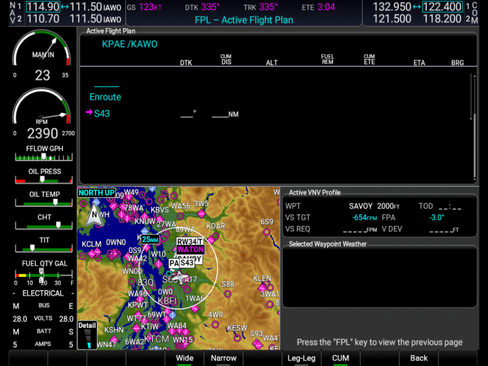
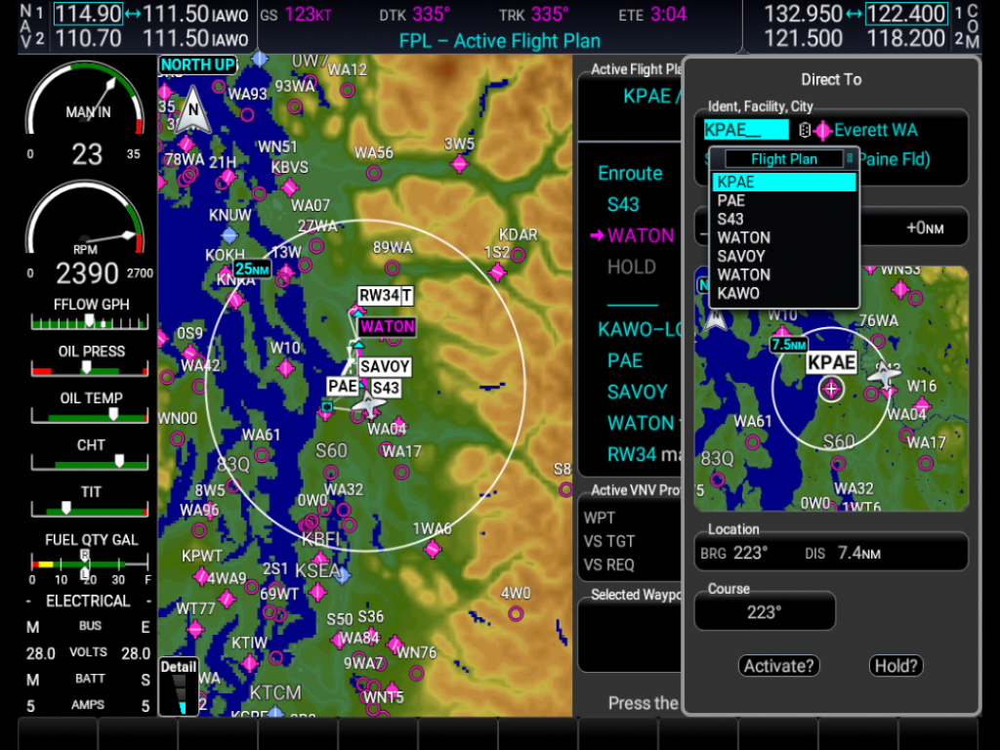
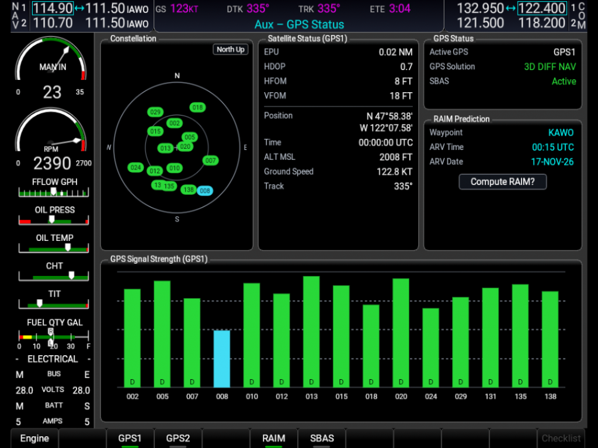
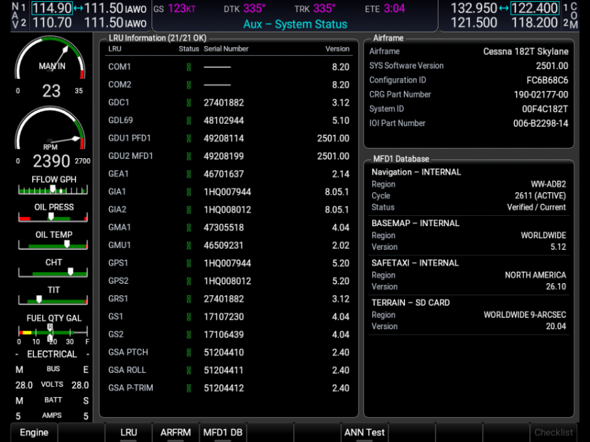
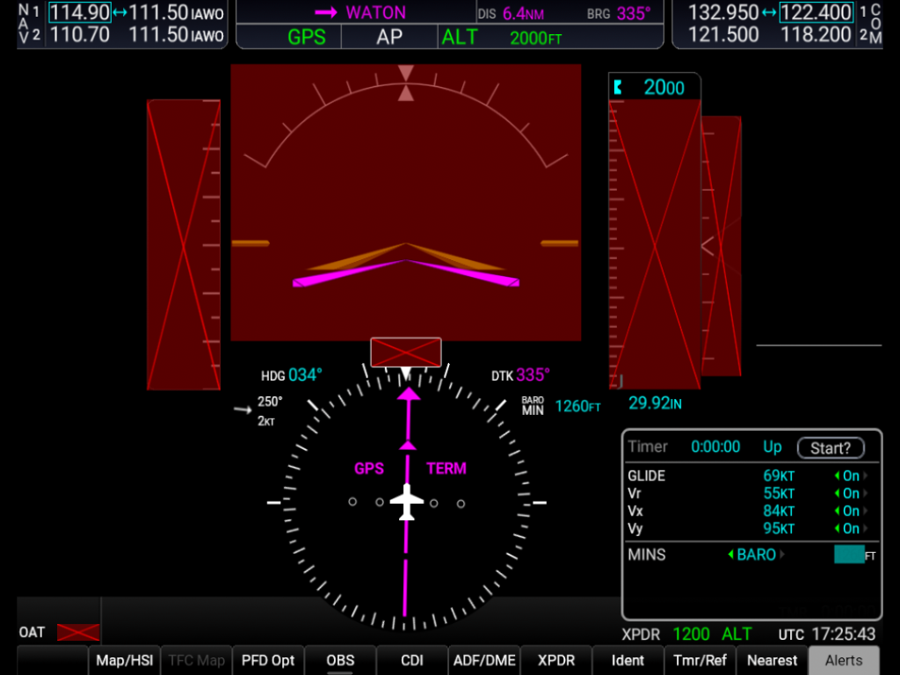
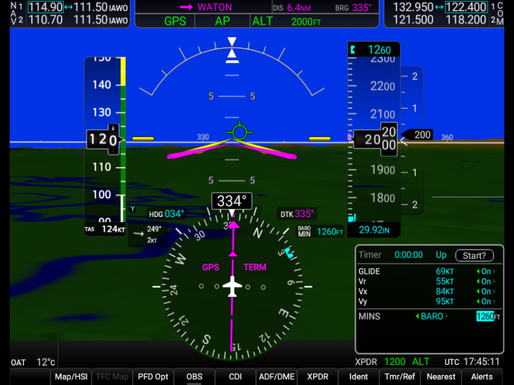

# Garmin G1000 NXi Real-World Avionics Enhancements (`v2.0.0` / `Build 800`)

**Standalone Community Package:** `wtg1000-nxi-enhancements`  
**Release Archive:** `1-G1000NXi-Avionics-Enhancements-v2.0.0.zip`  
**Dependencies:** None (works standalone on every MSFS 2020 G1000 NXi aircraft — Cessna 172S, Carenado CT182T, C208B, G36, G58, DA40NG, DA62, SR22, etc.)  
**Simulator Compatibility:** Microsoft Flight Simulator 2020 (SU15+ / Working Title G1000 NXi) — zero Official files modified.

---

## In-Game Panel Screenshots

### 1. Missed-Approach `Load?` Continuity & Active Hold Preservation
Load a new approach (`PROC → Select Approach → Load?`) while flying inbound to or holding at the final missed-approach fix without dropping the active leg, disturbing LNAV, or triggering a course jump.


### 2. MFD `Wide` / `Narrow` Flight Plan View & `CUM` / `Leg-Leg` Totals
Switch between `Narrow` and `Wide` FPL display (`View` softkey) to view live `DTK`, `DIS` / `CUM DIS`, `ALT`, `FUEL REM`, `ETE` / `CUM ETE`, `ETA`, and `BRG` alongside the moving map inset.



### 3. Counter-Clockwise Small FMS Knob 4-Tab Waypoint Submenu
Turning the small FMS knob counter-clockwise on any waypoint input opens the real-world 4-tab selection submenu (**Flight Plan**, **Nearest**, **Recent**, **User**).



### 4. `Aux – GPS Status` Page (Constellation Skyview, WAAS & RAIM)
Live North-Up satellite skyview, `GPS1`/`GPS2` receiver toggle, WAAS SBAS PRNs (`131`, `135`, `138`) with differential `D` bars, EPU/HDOP/HFOM/VFOM telemetry, and interactive **RAIM Prediction**.



### 5. `Aux – System Status` Page (21 G1000 LRUs & Dynamic Airframe Info)
Displays live operational status for all 21 G1000 LRUs (`COM1/2`, `GDC1`, `GDL69`, `GDU1/2`, `GEA1`, `GIA1/2`, `GMA1`, `GMU1`, `GPS1/2`, `GRS1`, `GS1/2`, `GSA` servos, `GTS800`, `GTX1`), dynamic airframe identification, software versions, and active navigation database cycle.



### 6. Garmin `190-02177-00` 36-Component Avionics Failure Simulation
Authentic Red-X invalidations (shown below: **AHRS1 + ADC1 Partial-Panel** with Attitude, Heading, Airspeed, Altimeter, VSI, and OAT Red-X overlays plus CAS `Alerts`), GPS LOI / Dead Reckoning (`DR`), pitot/static blockages without Red-X, and manual **`DISPLAY BACKUP`** native PFD-on-MFD reversionary display.



### 7. Approach `ALT` Outer-Knob Stepdown & Minimums Snapping (`1260` FT Bug)
Turning the outer `ALT` knob counter-clockwise on an approach snaps the cyan Selected Altitude bug cleanly through published stepdowns (`2000 → 1700`) and directly onto non-100-ft minimums (**`1260`** matching `BARO MIN 1260FT`, impossible on stock WTG1000 which is locked to 100-ft increments).



---

## Release Notes — `v2.0.0` (`Build 800`)

### What's New in `v2.0.0`
- **Clean Modular Architecture**: Separated core G1000 NXi avionics enhancements (`wtg1000-nxi-enhancements`) from US Procedure Fixes (Project 2) and C172S Flight Model (Project 3) so users can install any component independently.
- **36-Component Avionics Failure Engine (`Garmin 190-02177-00`)**:
  - Full cascading LRU dependency graph (`GDC1`, `GRS1`, `GMU1`, `GIA1/2`, `GPS1/2`, `GDU1/2`, `GEA1`, `GMA1`, `GTX1`, `GDL69`, `GS1/2`, `GSA` servos, `GTS800`) plus subtle non-Red-X instrument errors (pitot icing blockage, static port blockage, WAAS loss, RAIM LOI, AHRS alignment banner, stuck COM PTT, TAWS fail).
  - Authentic **manual `DISPLAY BACKUP`** behavior: failing PFD1 (`GDU1`) or MFD1 (`GDU2`) blanks only the failed screen without auto-reverting; pressing the red `DISPLAY BACKUP` button activates a full native PFD-on-MFD Reversionary Display (attitude, tapes, VSI, HSI, EIS strip, COM/NAV/FMA, inset map, and softkeys).
  - Controlled via L:Vars or remotely over browser/iPad using **Project 4 (IFR Trainer & Instructor Station)**.
- **Bidirectional FMS Sync Bridge**: Allows external training apps (Project 4) to read the active G1000 flight plan or push new Victor-airway / Direct-To routes straight into the live G1000 FMS.

### Core Real-World G1000 NXi Avionics Fixes Included
- **Missed-Approach `Load?` Continuity**: `PROC → Select Approach → Load?` while inbound to or holding at the final missed-approach fix preserves the active missed leg and hold with zero LNAV jump or bank transient.
- **CCW Small FMS Knob 4-Tab Waypoint Submenu**: Instant access to `Flight Plan`, `Nearest`, `Recent`, and `User` waypoints on every ident input field.
- **MFD `Wide` / `Narrow` FPL View + `CUM` / `Leg-Leg`**: Full `FUEL REM`, `ETE`, `ETA`, and `BRG` columns via the `View` softkey.
- **`Aux – GPS Status` & `Aux – System Status`**: Restores both missing MFD AUX pages with live telemetry and LRU health.
- **Approach `ALT` Outer Knob Snapping** (*Garmin Pilot's Guide* p. 49): Snaps smoothly through published approach stepdown altitudes and minimums.
- **Seamless ILS/LOC Automatic `GPS → LOC` (`Nav-to-Nav`) + `GS` Capture** (*Pilot's Guide* pp. 352, 360–363): Fixes cases where stock WTG1000 failed to auto-switch CDI from GPS to LOC or missed glideslope capture on localizer intercept.
- **14 Pilot Usability Enhancements**: `ACT Leg` softkey, Along-Track Offset (`ATK OFS`), Direct-To VNV offset, Facility Name/City search, `Hold at Present Position (PPOS)`, Stored Flight Plan Catalog, User Waypoints synced PFD↔MFD, Nearest Frequencies, Map Pointer snap/measure, Temperature Compensation (`Temp Comp`), Closest Point of FPL, and 2-second `121.500 MHz` emergency COM hold.

---

## Manual Installation Guide (Without Using an `.exe` Installer)

You do **not** need any installer executable to install this mod. It is a standard MSFS 2020 Community add-on package.

### Step 1 — Locate Your MSFS 2020 `Community` Folder
Choose the path matching your MSFS 2020 edition:

- **Steam Edition (Default):**
  ```text
  %APPDATA%\Microsoft Flight Simulator\Packages\Community
  ```
  *(Typically `C:\Users\<YourName>\AppData\Roaming\Microsoft Flight Simulator\Packages\Community`)*

- **Microsoft Store / Xbox Game Pass Edition (Default):**
  ```text
  %LOCALAPPDATA%\Packages\Microsoft.FlightSimulator_8wekyb3d8bbwe\LocalCache\Packages\Community
  ```

- **Custom Install Location (If You Moved Packages to Another Drive):**
  Open `UserCfg.opt` in Notepad:
  - Steam: `%APPDATA%\Microsoft Flight Simulator\UserCfg.opt`
  - MS Store: `%LOCALAPPDATA%\Packages\Microsoft.FlightSimulator_8wekyb3d8bbwe\LocalCache\UserCfg.opt`

  Scroll to the very last line:
  ```text
  InstalledPackagesPath "D:\MSFS\Packages"
  ```
  Your `Community` folder is `<InstalledPackagesPath>\Community` (e.g., `D:\MSFS\Packages\Community`).

### Step 2 — Extract & Copy the Package Folder
1. **Close Microsoft Flight Simulator** if it is currently running.
2. Download `1-G1000NXi-Avionics-Enhancements-v2.0.0.zip` from GitHub Releases and extract it.
3. Copy the **`wtg1000-nxi-enhancements`** folder directly into your `Community` folder.

> [!IMPORTANT]
> **Avoid Nested Folders!** After copying, verify that `manifest.json` sits directly inside `Community\wtg1000-nxi-enhancements\`:
> ```text
> Community\
> └── wtg1000-nxi-enhancements\
>     ├── layout.json
>     ├── manifest.json
>     └── html_ui\
>         ├── Plugins\wtg1000-nxi-enhancements.xml
>         └── WTG1000NxiEnhancements\wtg1000-nxi-enhancements.js
> ```
> If you accidentally end up with `Community\1-G1000NXi-Avionics-Enhancements-v2.0.0\wtg1000-nxi-enhancements\`, MSFS will **not** load the package. Move the inner `wtg1000-nxi-enhancements` folder up one level.

### Step 3 — Verify Inside MSFS 2020
1. Launch MSFS 2020 and load into any G1000 NXi aircraft (e.g., Cessna 172 Skyhawk G1000).
2. On the MFD, press **`FPL`** and confirm the **`View`** and **`ATK OFS`** softkeys are active along the bottom bezel.
3. Rotate the **Large FMS Knob** to the **`AUX`** page group and rotate the **Small FMS Knob** to verify **`Aux – GPS Status`** and **`Aux – System Status`** appear.

### Uninstalling
1. Close MSFS 2020.
2. Delete the `Community\wtg1000-nxi-enhancements` folder.
